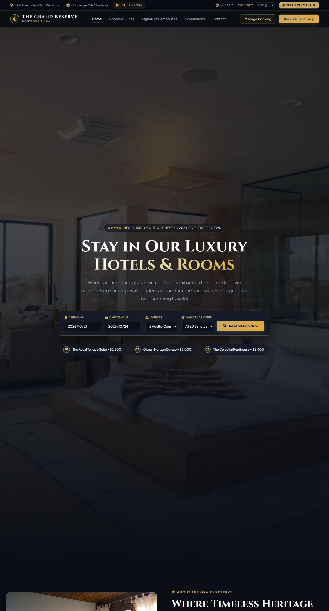

# 🏛 Builder Handover Brief: Home Landing Page

> **Builder:** Mission (Assigned to `web/index.html` & `web/css/home.css`)  
> **From:** Emmanuel (Lead Architect & Database Developer)  
> **Visual Reference:** [`docs/screenshots/home-reference.png`](../screenshots/home-reference.png)

---

## 1. Why I Chose You for the Home Page

Mission, I chose you specifically for the Home Page because you have a natural instinct for visual balance and first impressions. The home page is the grand lobby of our hotel. If a guest steps in and it feels cluttered or confusing, they leave. But if it feels calm, moody, and prestigious, they immediately want to book. 

I know you have the patience to get the typography looking crisp, the gold gradients feeling subtle rather than loud, and the layout feeling spacious. I trust you with this because you don't rush; you care about the small visual details that turn a good webpage into a five-star experience.

*(Note: Don't worry at all about the Contact page—I am personally building `contact.html` and its styling myself, so your sole focus is making this home page extraordinary!)*

---

## 2. Your Visual Focal Point

Look closely at your reference screenshot in `docs/screenshots/home-reference.png`:



### What Makes This Page Look Luxurious (Plain English):
1. **The Deep Obsidian Background:** Notice that it's not pitch black—it's a deep midnight navy (`#0B0E14`). This allows our champagne gold buttons and crisp white headings to glow naturally without straining the eyes.
2. **The Ambient Gold Hero Headline:** The headline uses a serif font (`Cinzel`) where the text transitions smoothly from pure white into radiant gold.
3. **The Compact Top Micro-Bar:** A neat 30px bar at the very top showing the hotel's address, 24/7 concierge status, live local weather (`24°C`), live time, and a currency dropdown.
4. **The Quick Booking Bar:** A dark glassmorphic box resting right on the hero photo, letting guests pick check-in, check-out, guests, and suite tier in one click.
5. **The Smooth Wave Transition:** A subtle curved wave divider that flows smoothly from the hero photo into the About section below.

---

## 3. Generous Starter: HTML Scaffold

Here is your starter skeleton. You don't need to write this from scratch—use this as your solid foundation and build each section out:

```html
<!DOCTYPE html>
<html lang="en">
<head>
  <meta charset="UTF-8">
  <meta name="viewport" content="width=device-width, initial-scale=1.0">
  <title>The Grand Reserve | Luxury Boutique Hotel & Spa</title>
  
  <!-- FontAwesome 6 Icons & Google Fonts -->
  <link rel="stylesheet" href="https://cdnjs.cloudflare.com/ajax/libs/font-awesome/6.4.0/css/all.min.css">
  
  <!-- Shared Global Styles (DO NOT EDIT global.css) -->
  <link rel="stylesheet" href="css/global.css">
  
  <!-- Your Dedicated Page Stylesheet -->
  <link rel="stylesheet" href="css/home.css">
</head>
<body>

  <!-- ========================================================
       1. TOP MICRO-BAR (Address, Live Weather, Clock, Currency)
       ======================================================== -->
  <div class="top-microbar">
    <div class="top-microbar-container">
      <div class="top-bar-left">
        <span class="top-item"><i class="fas fa-map-marker-alt"></i> 104 Ocean View Blvd, Waterfront</span>
        <span class="top-item"><i class="fas fa-clock"></i> Concierge: 24/7 Available</span>
        <!-- Weather Badge: Hooked up automatically by weather.js -->
        <span class="weather-badge" id="liveWeatherBadge">
          <i class="fas fa-sun" id="weatherIcon"></i>
          <span id="weatherTemp">24°C</span>
          <span id="weatherDesc" style="color: var(--text-secondary); margin-left: 4px;">Coastal Breeze</span>
        </span>
      </div>
      <div class="top-bar-right">
        <!-- Live Clock: Hooked up automatically by main.js -->
        <span class="top-item"><i class="fas fa-clock-rotate-left"></i> <span id="liveHotelClock">--:--</span></span>
        <div class="top-item">
          <label for="currencySelector" style="font-size: 0.72rem; text-transform: uppercase; color: var(--gold-primary);">Currency:</label>
          <select id="currencySelector" class="currency-select">
            <option value="USD">USD ($)</option>
            <option value="EUR">EUR (€)</option>
            <option value="GBP">GBP (£)</option>
            <option value="ZAR">ZAR (R)</option>
          </select>
        </div>
        <a href="confirmation.html" class="top-cta-btn"><i class="fas fa-key"></i> Check In / Manage</a>
      </div>
    </div>
  </div>

  <!-- ========================================================
       2. PRIMARY HEADER & NAVIGATION
       ======================================================== -->
  <header class="site-header">
    <div class="header-container">
      <a href="index.html" class="brand-logo">
        <div class="brand-emblem"><i class="fas fa-moon"></i></div>
        <div class="brand-text">
          <span class="brand-name">THE GRAND RESERVE</span>
          <span class="brand-tagline">Boutique & Spa</span>
        </div>
      </a>

      <nav class="site-nav">
        <a href="index.html" class="nav-link active">Home</a>
        <a href="rooms.html" class="nav-link">Rooms & Suites</a>
        <a href="rooms.html?type=suite" class="nav-link">Signature Penthouses</a>
        <a href="#amenities" class="nav-link">Experiences</a>
        <a href="contact.html" class="nav-link">Contact</a>
      </nav>

      <div class="nav-cta-group">
        <a href="confirmation.html" class="btn-nav-outline">Manage Booking</a>
        <a href="rooms.html" class="btn-nav-gold">Reserve Sanctuary</a>
        <button class="mobile-menu-btn"><i class="fas fa-bars"></i></button>
      </div>
    </div>
  </header>

  <!-- ========================================================
       3. HERO SANCTUARY SECTION
       ======================================================== -->
  <section class="hero-section">
    <div class="hero-overlay-glow"></div>
    <div class="hero-content">
      
      <!-- Rating pill at top -->
      <div class="hero-rating-pill">
        <span class="hero-rating-stars">★★★★★</span>
        <span>BEST LUXURY BOUTIQUE HOTEL • 20K+ REVIEWS</span>
      </div>

      <!-- Main Headline with gold gradient -->
      <h1 class="hero-title">Stay in Our <span>Luxury Hotels & Rooms</span></h1>
      <p class="hero-subtitle">
        Where architectural grandeur meets tranquil ocean horizons. Discover handcrafted suites, private butler care, and serene sanctuaries designed for the discerning traveler.
      </p>

      <!-- Booking Quick Search Bar (Form passes dates to rooms.html) -->
      <form class="booking-search-bar" action="rooms.html" method="GET">
        <div class="search-field">
          <label class="search-label"><i class="fas fa-calendar-check"></i> Check-In</label>
          <div class="search-input-wrap">
            <input type="date" name="checkIn" id="searchCheckIn" required>
          </div>
        </div>

        <div class="search-field">
          <label class="search-label"><i class="fas fa-calendar-xmark"></i> Check-Out</label>
          <div class="search-input-wrap">
            <input type="date" name="checkOut" id="searchCheckOut" required>
          </div>
        </div>

        <div class="search-field">
          <label class="search-label"><i class="fas fa-user-group"></i> Guests</label>
          <div class="search-input-wrap">
            <select name="guests" id="searchGuests">
              <option value="1">1 Adult</option>
              <option value="2" selected>2 Adults</option>
              <option value="3">3 Guests</option>
              <option value="4">4 Guests</option>
            </select>
          </div>
        </div>

        <div class="search-field">
          <label class="search-label"><i class="fas fa-layer-group"></i> Sanctuary Tier</label>
          <div class="search-input-wrap">
            <select name="type" id="searchType">
              <option value="all">All 20 Sanctuaries</option>
              <option value="suite">Signature Suites</option>
              <option value="deluxe">Deluxe Ocean Rooms</option>
              <option value="double">Executive Double</option>
              <option value="single">Classic Single</option>
            </select>
          </div>
        </div>

        <button type="submit" class="btn-primary btn-search-submit">
          <i class="fas fa-search"></i> Reservation Now
        </button>
      </form>

      <!-- 3 Suite Preview Pills (01, 02, 03) -->
      <div class="hero-pills-row">
        <!-- Add your 3 pill links here targeting rooms.html?roomId=9, 13, 15 -->
      </div>
    </div>
  </section>

  <!-- ========================================================
       4. CURVED WAVE DIVIDER
       ======================================================== -->
  <div class="curved-wave-divider">
    <svg viewBox="0 0 1200 120" preserveAspectRatio="none">
      <path d="M0,0 C150,90 350,-40 500,40 C650,120 900,20 1200,60 L1200,120 L0,120 Z" class="shape-fill"></path>
    </svg>
  </div>

  <!-- Build the About section and Curated Amenities grid next! -->

  <!-- Scripts: Loaded in order -->
  <script src="js/rooms-data.js"></script>
  <script src="js/weather.js"></script>
  <script src="js/main.js"></script>
</body>
</html>
```

---

## 4. Generous Starter: Key CSS Layout Rules (`home.css`)

Here are the key layout styles to get the hero and search bar aligned perfectly:

```css
/* Hero background with dark overlay */
.hero-section {
  position: relative;
  min-height: 85vh;
  display: flex;
  align-items: center;
  justify-content: center;
  padding: 80px 24px 140px;
  background: 
    linear-gradient(180deg, rgba(11, 14, 20, 0.65) 0%, rgba(11, 14, 20, 0.85) 65%, #0B0E14 100%),
    url('https://images.unsplash.com/photo-1578683010236-d716f9a3f461?auto=format&fit=crop&w=2000&q=85') center/cover no-repeat;
  text-align: center;
}

/* Gold Gradient Headline */
.hero-title span {
  background: linear-gradient(135deg, #FFFFFF 30%, var(--gold-bright) 100%);
  -webkit-background-clip: text;
  -webkit-text-fill-color: transparent;
}

/* 4-column search bar */
.booking-search-bar {
  background: rgba(19, 26, 41, 0.95);
  backdrop-filter: blur(16px);
  border: 1px solid var(--border-gold);
  border-radius: var(--radius-md);
  padding: 18px 24px;
  display: grid;
  grid-template-columns: repeat(4, 1fr) auto;
  gap: 16px;
  align-items: center;
  max-width: 1140px;
  margin: 0 auto;
}
```

---

## 5. Heavy Assistance on JavaScript (I've Got Your Back)

You do **not** need to code the complex JavaScript for the weather or clock from scratch. I have already built the core scripts:
* **`js/weather.js`**: Automatically contacts the Open-Meteo REST API, checks the temperature at Waterfront, and fills `#weatherTemp` and `#weatherIcon`. If offline, it provides a realistic sunny forecast so your page never breaks.
* **`js/main.js`**: Automatically updates `#liveHotelClock` every 30 seconds and adds a dark blur effect to the navigation bar when the guest scrolls down.

All you need to do is keep the exact element IDs (`liveWeatherBadge`, `weatherTemp`, `weatherIcon`, `liveHotelClock`) in your HTML, and the scripts will do all the heavy lifting for you!

Mission, make our grand lobby unforgettable.

