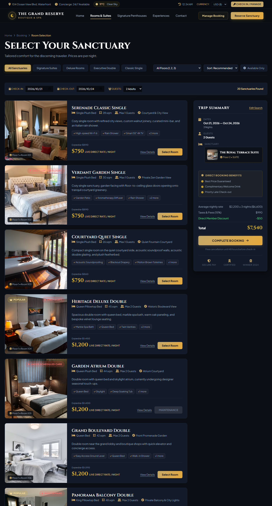

# 🏛 Builder Handover Brief: Rooms Gallery & Live Trip Summary

> **Builder:** Stacy (Assigned to `web/rooms.html` & `web/css/rooms.css`)  
> **From:** Emmanuel (Lead Architect & Database Developer)  
> **Visual Reference:** [`docs/screenshots/rooms-reference.png`](../screenshots/rooms-reference.png)

---

## 1. Why I Chose You for the Rooms Gallery

Stacy, I hand-picked you for the **Rooms Gallery and Trip Summary** because this is the commercial heart of the entire hotel. If guests cannot easily browse through our 20 rooms or see their live pricing breakdown, the whole system stalls. 

You have a fantastic eye for structured catalogs, and you know how to make interactive elements feel crisp and satisfying to click. You will be presenting 20 authentic rooms across 3 floors (Single, Double, Suite, Deluxe) paired with our signature sticky Trip Summary sidebar that recalculates costs on the fly. 

*(Remember: The Contact page is being handled completely by me (`contact.html`), so you can pour 100% of your energy into this rooms experience!)*

---

## 2. Your Visual Focal Point

Open up your reference screenshot in `docs/screenshots/rooms-reference.png`:



### What Makes This Page Work (Plain English):
1. **The Top Filter Tag Pills:** Simple, rounded pill buttons (All Sanctuaries, Signature Suites, Deluxe Rooms, Executive Double, Classic Single). The selected pill turns solid champagne gold (`#C5A869`) with dark bold text.
2. **The 2-Column Grid Layout:** The left column (about 65% wide) holds the room cards. The right column (about 35% wide) holds the **sticky Trip Summary sidebar** that stays pinned to the screen as the guest scrolls.
3. **The Anatomy of a Room Card:** 
   * Left side: Room photo with small badges (*Recommended*, *Only 2 Left*, *Floor 1/2/3*).
   * Right side: Room title, spec icons (Bed size, sqm, guests, view), brief description, crossed-out comparator rate (`Expedia: $XXX`), large bold gold **Live Direct Rate**, a "View Details" link, and a gold "Select Room" button.
4. **The Sticky Trip Summary:** Keeps track of Check-in/Check-out dates, nights, guests, selected room, direct booking benefits, 15% taxes, and the large gold grand total.

---

## 3. Generous Starter: HTML Scaffold (`rooms.html`)

Here is your starting foundation. It establishes the 2-column workspace and all the hooks needed for dynamic rendering:

```html
<!DOCTYPE html>
<html lang="en">
<head>
  <meta charset="UTF-8">
  <meta name="viewport" content="width=device-width, initial-scale=1.0">
  <title>Select Your Sanctuary | The Grand Reserve</title>
  
  <link rel="stylesheet" href="https://cdnjs.cloudflare.com/ajax/libs/font-awesome/6.4.0/css/all.min.css">
  <link rel="stylesheet" href="css/global.css">
  <link rel="stylesheet" href="css/rooms.css">
</head>
<body>

  <!-- Top Micro-bar & Site Header (Matches global.css) -->
  <header class="site-header">
    <div class="header-container">
      <a href="index.html" class="brand-logo">
        <div class="brand-emblem"><i class="fas fa-moon"></i></div>
        <div class="brand-text">
          <span class="brand-name">THE GRAND RESERVE</span>
          <span class="brand-tagline">Boutique & Spa</span>
        </div>
      </a>
      <nav class="site-nav">
        <a href="index.html" class="nav-link">Home</a>
        <a href="rooms.html" class="nav-link active">Rooms & Suites</a>
        <a href="contact.html" class="nav-link">Contact</a>
      </nav>
      <div class="nav-cta-group">
        <a href="confirmation.html" class="btn-nav-outline">Manage Booking</a>
        <a href="rooms.html" class="btn-nav-gold">Reserve Sanctuary</a>
      </div>
    </div>
  </header>

  <main class="rooms-catalog-section">
    <div class="container">
      
      <!-- Breadcrumb Bar -->
      <nav class="breadcrumb-bar">
        <ol class="breadcrumb-list">
          <li><a href="index.html">Home</a></li>
          <li class="breadcrumb-sep"><i class="fas fa-chevron-right"></i></li>
          <li class="breadcrumb-current">Room Selection</li>
        </ol>
      </nav>

      <div class="page-header">
        <h1 class="page-title">Select Your Sanctuary</h1>
        <p class="page-subtitle">Tailored comfort for the discerning traveler. Prices are per night.</p>
      </div>

      <!-- Filter Tags Bar (Clicking changes active room filter) -->
      <div class="filter-tags-bar">
        <div class="filter-pills-list">
          <button class="filter-pill active" data-filter="all">All Sanctuaries</button>
          <button class="filter-pill" data-filter="suite">Signature Suites</button>
          <button class="filter-pill" data-filter="deluxe">Deluxe Rooms</button>
          <button class="filter-pill" data-filter="double">Executive Double</button>
          <button class="filter-pill" data-filter="single">Classic Single</button>
        </div>

        <div class="filter-controls-right">
          <select class="filter-select" id="floorFilterSelect">
            <option value="all">All Floors (1, 2, 3)</option>
            <option value="1">Floor 1 - Courtyard & Garden</option>
            <option value="2">Floor 2 - Panoramic Mid-Level</option>
            <option value="3">Floor 3 - Top Floor Penthouses</option>
          </select>

          <select class="filter-select" id="sortFilterSelect">
            <option value="featured">Sort: Recommended</option>
            <option value="price-low">Price: Low to High</option>
            <option value="price-high">Price: High to Low</option>
          </select>
        </div>
      </div>

      <!-- Two-Column Layout -->
      <div class="rooms-layout-grid">
        
        <!-- Left: 20 Rooms Container (Injected by JavaScript) -->
        <div class="rooms-cards-container" id="roomsListContainer">
          <!-- Room cards will be rendered here dynamically -->
        </div>

        <!-- Right: Sticky Trip Summary Sidebar -->
        <aside class="trip-summary-sidebar">
          <div class="trip-summary-header">
            <h2 class="trip-summary-title">Trip Summary</h2>
            <a href="#searchCheckIn" class="btn-edit-search">Edit Search</a>
          </div>

          <div class="trip-detail-items">
            <div class="trip-detail-row">
              <i class="fas fa-calendar trip-detail-icon"></i>
              <div>
                <div class="trip-detail-label">Dates</div>
                <div class="trip-detail-val" id="summaryDates">Oct 24 — Oct 27, 2026</div>
                <div class="trip-detail-sub" id="summaryNights">3 Nights</div>
              </div>
            </div>

            <div class="trip-detail-row">
              <i class="fas fa-bed trip-detail-icon"></i>
              <div style="width: 100%;">
                <div class="trip-detail-label">Sanctuary</div>
                <div id="summarySanctuary" style="margin-top: 6px;">
                  <!-- Selected room thumbnail & title will appear here -->
                </div>
              </div>
            </div>
          </div>

          <!-- Direct Benefits Card -->
          <div class="direct-benefits-card">
            <div class="direct-benefits-title"><i class="fas fa-certificate"></i> Direct Booking Benefits</div>
            <ul class="direct-benefits-list">
              <li><i class="fas fa-check"></i> Best Price Guaranteed</li>
              <li><i class="fas fa-check"></i> Complimentary Welcome Drink</li>
              <li><i class="fas fa-check"></i> Priority Late Check-out</li>
            </ul>
          </div>

          <!-- Financial Breakdown -->
          <div class="trip-price-breakdown">
            <div class="breakdown-row">
              <span>Average nightly rate</span>
              <span id="summaryRate">$0.00</span>
            </div>
            <div class="breakdown-row">
              <span>Taxes & Fees (15%)</span>
              <span id="summaryTaxes">$0.00</span>
            </div>
            <div class="breakdown-row discount">
              <span>Direct Member Discount</span>
              <span id="summaryDiscount">-$50.00</span>
            </div>
            <div class="breakdown-row total-row">
              <strong>Total</strong>
              <span class="total-gold-amount" id="summaryTotal">$0.00</span>
            </div>
          </div>

          <button class="btn-primary btn-complete-booking" id="completeBookingBtn">
            Complete Booking
          </button>
        </aside>

      </div>
    </div>
  </main>

  <!-- Scripts: Crucial order -->
  <script src="js/rooms-data.js"></script>
  <script src="js/weather.js"></script>
  <script src="js/main.js"></script>
  <script src="js/booking.js"></script>
</body>
</html>
```

---

## 4. Generous Starter: Key CSS Layout Rules (`rooms.css`)

Here is how you lock in the 2-column layout and the sticky sidebar:

```css
/* 2-column layout: Left column expands, right column fixed at 380px */
.rooms-layout-grid {
  display: grid;
  grid-template-columns: 1fr 380px;
  gap: 32px;
  align-items: start;
}

/* Sticky Trip Summary Sidebar */
.trip-summary-sidebar {
  position: sticky;
  top: 96px; /* Sits comfortably below the header */
  background: var(--bg-card);
  border: 1px solid var(--border-card);
  border-radius: var(--radius-md);
  padding: 24px;
}

/* Room card horizontal layout */
.room-card {
  background: var(--bg-card);
  border: 1px solid var(--border-card);
  border-radius: var(--radius-md);
  overflow: hidden;
  display: grid;
  grid-template-columns: 320px 1fr;
  transition: all 0.3s ease;
}

.room-card.selected {
  border: 2px solid var(--gold-bright);
  box-shadow: 0 0 25px rgba(212, 175, 55, 0.25);
}
```

---

## 5. Heavy Assistance on JavaScript (I've Done the Math)

You don't have to worry about writing complicated calculation algorithms. In `js/booking.js`, I have already written:
1. `ROOMS_DATA`: The complete list of all 20 rooms with photos, prices, bed specs, views, and floor numbers.
2. `selectSanctuary(roomId)`: Automatically highlights the selected card and recalculates:
   * Nights: `(CheckOutDate - CheckInDate)`
   * Subtotal: `PricePerNight * Nights`
   * Tax: `15% of Subtotal`
   * Member Discount: `-$50.00`
   * Grand Total: `Subtotal + Tax - Discount`
3. Filter & Sort handlers: Filter by suite type or floor with one line of code!

Just ensure your HTML container has `id="roomsListContainer"` and your summary elements use the IDs in the scaffold (`summaryDates`, `summaryNights`, `summaryRate`, `summaryTotal`), and `booking.js` will handle all the rendering seamlessly.

Stacy, you are building the core of our hotel. Make it shine!

