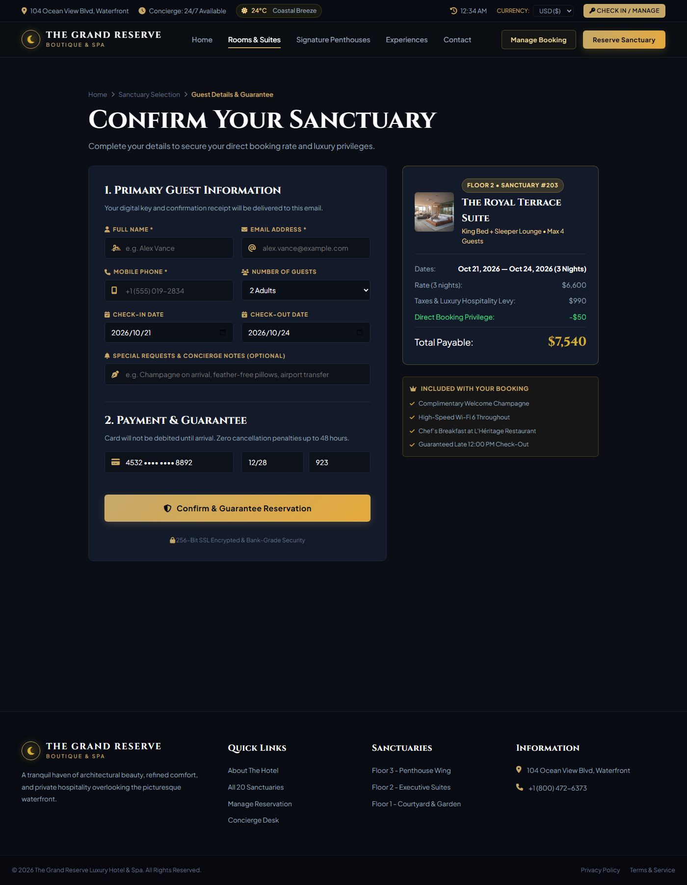

# 🏛 Builder Handover Brief: Reservation Checkout & Payment Guarantee

> **Builder:** Blessing (Assigned to `web/booking.html` & `web/css/booking.css`)  
> **From:** Emmanuel (Lead Architect & Database Developer)  
> **Visual Reference:** [`docs/screenshots/booking-reference.png`](../screenshots/booking-reference.png)

---

## 1. Why I Chose You for the Booking Checkout

Blessing, I selected you for the **Checkout and Guarantee Flow** because this is the critical moment of trust. A guest has fallen in love with a suite, but now they are entering their personal contact information and securing their reservation. If this form feels clunky, if inputs feel misaligned, or if the summary is unclear, guests hesitate and leave.

You have a remarkable talent for building structured, clean forms with clear validation and reassurance. You understand how to make a guest feel completely safe and valued.

*(Note: Don't spend any time on the Contact page—I am building `contact.html` myself! Your single goal is making this checkout flow seamless and secure.)*

---

## 2. Your Visual Focal Point

Open your reference screenshot in `docs/screenshots/booking-reference.png`:



### What Makes This Page Reassuring (Plain English):
1. **The 2-Column Checkout Grid:** 
   * Left side (about 60% wide): Clean guest form fields (Name, Email, Phone, Dates, Special Requests) followed by the simulated Card Guarantee box.
   * Right side (about 40% wide): The **Selected Room Recap Card** showing the suite's thumbnail photo, stay dates, nightly rate, taxes, discount, and grand total.
2. **Luxury Form Inputs with Icons:** Notice that every text field has a small gold icon resting inside the left edge (like a signature icon for the name, or an envelope for email). This makes the form look high-end rather than generic.
3. **No Upfront Charge Notice:** Clear, comforting text informing the guest that their card will only guarantee the room and will not be charged until check-in.

---

## 3. Generous Starter: HTML Scaffold (`booking.html`)

Here is your starting foundation. It connects directly with the parameters passed from Stacy's rooms page:

```html
<!DOCTYPE html>
<html lang="en">
<head>
  <meta charset="UTF-8">
  <meta name="viewport" content="width=device-width, initial-scale=1.0">
  <title>Complete Reservation | The Grand Reserve</title>
  
  <link rel="stylesheet" href="https://cdnjs.cloudflare.com/ajax/libs/font-awesome/6.4.0/css/all.min.css">
  <link rel="stylesheet" href="css/global.css">
  <link rel="stylesheet" href="css/booking.css">
</head>
<body>

  <!-- Site Header (Matches global.css) -->
  <header class="site-header">
    <div class="header-container">
      <a href="index.html" class="brand-logo">
        <div class="brand-emblem"><i class="fas fa-moon"></i></div>
        <div class="brand-text">
          <span class="brand-name">THE GRAND RESERVE</span>
          <span class="brand-tagline">Boutique & Spa</span>
        </div>
      </a>
      <nav class="site-nav">
        <a href="index.html" class="nav-link">Home</a>
        <a href="rooms.html" class="nav-link">Rooms & Suites</a>
        <a href="contact.html" class="nav-link">Contact</a>
      </nav>
      <div class="nav-cta-group">
        <a href="confirmation.html" class="btn-nav-outline">Manage Booking</a>
        <a href="rooms.html" class="btn-nav-gold">Reserve Sanctuary</a>
      </div>
    </div>
  </header>

  <main class="rooms-catalog-section" style="padding-top: 40px;">
    <div class="container" style="max-width: 1040px;">

      <nav class="breadcrumb-bar">
        <ol class="breadcrumb-list">
          <li><a href="index.html">Home</a></li>
          <li class="breadcrumb-sep"><i class="fas fa-chevron-right"></i></li>
          <li><a href="rooms.html">Sanctuary Selection</a></li>
          <li class="breadcrumb-sep"><i class="fas fa-chevron-right"></i></li>
          <li class="breadcrumb-current">Guest Details & Guarantee</li>
        </ol>
      </nav>

      <div class="page-header" style="margin-bottom: 28px;">
        <h1 class="page-title">Confirm Your Sanctuary</h1>
        <p class="page-subtitle">Complete your details to secure your direct booking rate and luxury privileges.</p>
      </div>

      <!-- 2-Column Checkout Grid -->
      <div class="checkout-grid-container">
        
        <!-- Left Column: Guest Information & Card Form -->
        <div class="checkout-card">
          <h2 class="checkout-section-title">1. Primary Guest Information</h2>
          <p class="checkout-section-sub">Your digital key and confirmation receipt will be delivered to this email.</p>

          <form id="reservationCheckoutForm" class="contact-form">
            <div style="display: grid; grid-template-columns: 1fr 1fr; gap: 16px;">
              <div class="search-field">
                <label class="search-label" for="guestName"><i class="fas fa-user"></i> Full Name *</label>
                <div class="form-group-with-icon">
                  <i class="fas fa-signature"></i>
                  <input type="text" id="guestName" class="form-input-lux" placeholder="e.g. Alex Vance" required>
                </div>
              </div>

              <div class="search-field">
                <label class="search-label" for="guestEmail"><i class="fas fa-envelope"></i> Email Address *</label>
                <div class="form-group-with-icon">
                  <i class="fas fa-at"></i>
                  <input type="email" id="guestEmail" class="form-input-lux" placeholder="alex.vance@example.com" required>
                </div>
              </div>
            </div>

            <!-- Stay Dates Verification -->
            <div style="display: grid; grid-template-columns: 1fr 1fr; gap: 16px; margin-top: 14px;">
              <div class="search-field">
                <label class="search-label" for="formCheckIn"><i class="fas fa-calendar-check"></i> Check-in Date</label>
                <div class="search-input-wrap">
                  <input type="date" id="formCheckIn" required>
                </div>
              </div>

              <div class="search-field">
                <label class="search-label" for="formCheckOut"><i class="fas fa-calendar-xmark"></i> Check-out Date</label>
                <div class="search-input-wrap">
                  <input type="date" id="formCheckOut" required>
                </div>
              </div>
            </div>

            <!-- Simulated Payment Guarantee Box -->
            <div class="payment-guarantee-box">
              <h2 class="checkout-section-title">2. Payment & Guarantee</h2>
              <p class="checkout-section-sub">Zero cancellation penalties up to 48 hours before arrival.</p>

              <div style="display: grid; grid-template-columns: 1fr 1fr; gap: 16px; margin-bottom: 16px;">
                <div class="form-group-with-icon">
                  <i class="fas fa-credit-card"></i>
                  <input type="text" class="form-input-lux" placeholder="Card Number" value="4532 •••• •••• 8892">
                </div>
                <div style="display: grid; grid-template-columns: 1fr 1fr; gap: 10px;">
                  <input type="text" class="form-input-lux" placeholder="MM/YY" value="12/28" style="padding-left: 14px;">
                  <input type="text" class="form-input-lux" placeholder="CVV" value="923" style="padding-left: 14px;">
                </div>
              </div>
            </div>

            <button type="submit" class="btn-primary" style="width: 100%; padding: 16px; font-size: 1rem; margin-top: 12px;">
              <i class="fas fa-shield-alt"></i> Confirm & Guarantee Reservation
            </button>
          </form>
        </div>

        <!-- Right Column: Room Recap Container -->
        <aside>
          <!-- Dynamic recap rendered automatically by booking.js -->
          <div id="checkoutRoomRecap"></div>
        </aside>

      </div>
    </div>
  </main>

  <script src="js/rooms-data.js"></script>
  <script src="js/weather.js"></script>
  <script src="js/main.js"></script>
  <script src="js/booking.js"></script>
</body>
</html>
```

---

## 4. Generous Starter: Key CSS Layout Rules (`booking.css`)

Here is how you position the icons inside the input fields and format the 2-column grid:

```css
/* 2-column checkout grid */
.checkout-grid-container {
  display: grid;
  grid-template-columns: 1fr 400px;
  gap: 32px;
  align-items: start;
}

/* Luxury Input with inset icon */
.form-group-with-icon {
  position: relative;
  display: flex;
  align-items: center;
}

.form-group-with-icon i {
  position: absolute;
  left: 14px;
  color: var(--gold-primary);
  font-size: 0.95rem;
}

.form-input-lux {
  width: 100%;
  background: rgba(11, 14, 20, 0.7);
  border: 1px solid var(--border-card);
  border-radius: var(--radius-sm);
  padding: 12px 14px 12px 42px; /* Inset padding so text doesn't hit icon */
  font-size: 0.875rem;
  color: var(--text-white);
  outline: none;
  transition: all 0.2s ease;
}

.form-input-lux:focus {
  border-color: var(--gold-bright);
  box-shadow: 0 0 12px rgba(212, 175, 55, 0.2);
}
```

---

## 5. Heavy Assistance on JavaScript (I've Done the Complex Part)

You don't have to struggle with form submission or database communication. In `js/booking.js`, I wrote the entire `initBookingForm()` engine:
1. It automatically reads the URL parameters (`?roomId=9&checkIn=...`).
2. It generates the room card on the right inside `#checkoutRoomRecap`.
3. When the guest clicks "Confirm & Guarantee Reservation", it tries sending the booking to our backend server (`POST /api/reservations`).
4. If the backend server is offline, it automatically creates a confirmed booking code (e.g. `#LXB-99283`), saves the full booking record into `localStorage`, and forwards the guest to Terrance's `confirmation.html` page!

All you have to do is keep the form `id="reservationCheckoutForm"` and the input IDs (`guestName`, `guestEmail`, `formCheckIn`, `formCheckOut`).

Blessing, this is the moment of trust. You've got this!

