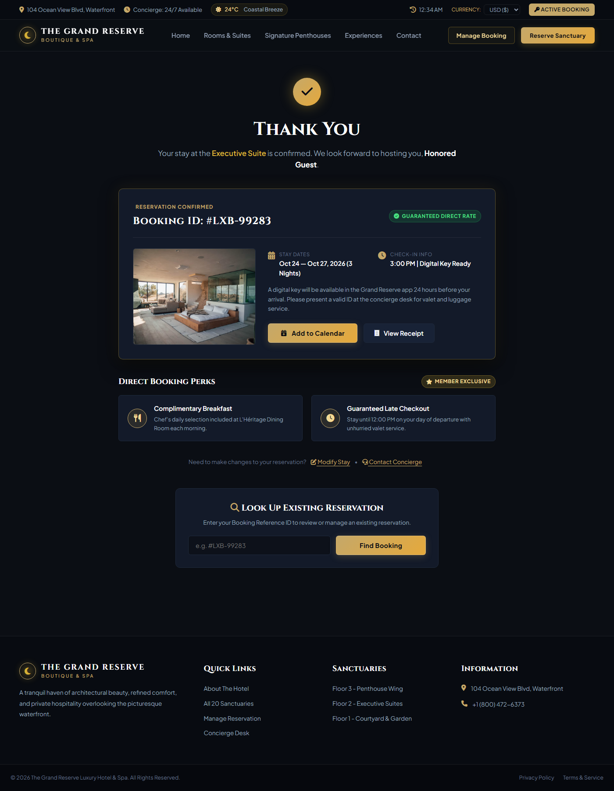

# 🏛 Builder Handover Brief: Confirmation & Manage Booking Portal

> **Builder:** Terrance (Assigned to `web/confirmation.html` & `web/css/confirmation.css`)  
> **From:** Emmanuel (Lead Architect & Database Developer)  
> **Visual Reference:** [`docs/screenshots/confirmation-reference.png`](../screenshots/confirmation-reference.png)

---

## 1. Why I Chose You for the Confirmation Page

Terrance, I selected you for the **Confirmation and Manage Booking Portal** because you understand that the guest's relationship with our hotel doesn't end when they click "Pay"—it truly begins right here.

When a guest sees their confirmation, they want instant reassurance: a clear Booking ID, arrival instructions for their digital key, direct booking benefits, a way to add their stay to their Google or Apple calendar, a formal printable tax receipt, and an easy lookup tool to check on their reservation anytime.

You have a fantastic sense of structure, clarity, and precision. You know how to make information look authoritative and satisfying.

*(Note: Don't worry about the Contact page—I am building `contact.html` myself! Your mission is delivering this world-class confirmation and booking management experience.)*

---

## 2. Your Visual Focal Point

Look at your reference screenshot in `docs/screenshots/confirmation-reference.png`:



### What Makes This Page Reassuring (Plain English):
1. **The Gold Checkmark Hero:** A clean, glowing circular badge with a checkmark, reading *"Thank You — Your stay at [Room Name] is confirmed"*.
2. **The Main Reservation Card:**
   * Top bar: Gold shield badge labeled *"RESERVATION CONFIRMED"* and the large bold Booking ID (e.g. `#LXB-99283`).
   * 2-column layout: High-res room photo on the left; Stay dates, Check-in Info (*3:00 PM | Digital Key Ready*), digital key instructions, and the two action buttons (*Add to Calendar* and *View Receipt*) on the right.
3. **The Direct Booking Perks Cards:** Two sleek cards highlighting *Complimentary Breakfast* (cutlery icon) and *Guaranteed Late Checkout* (clock icon).
4. **The Manage Booking Lookup Box:** A simple search box at the bottom where returning guests can type their Booking ID to instantly look up their stay.

---

## 3. Generous Starter: HTML Scaffold (`confirmation.html`)

Here is your starter foundation. It contains all the exact elements and IDs required:

```html
<!DOCTYPE html>
<html lang="en">
<head>
  <meta charset="UTF-8">
  <meta name="viewport" content="width=device-width, initial-scale=1.0">
  <title>Booking Confirmed | The Grand Reserve</title>
  
  <link rel="stylesheet" href="https://cdnjs.cloudflare.com/ajax/libs/font-awesome/6.4.0/css/all.min.css">
  <link rel="stylesheet" href="css/global.css">
  <link rel="stylesheet" href="css/confirmation.css">
</head>
<body>

  <!-- Site Header (Matches global.css) -->
  <header class="site-header">
    <div class="header-container">
      <a href="index.html" class="brand-logo">
        <div class="brand-emblem"><i class="fas fa-moon"></i></div>
        <div class="brand-text">
          <span class="brand-name">THE GRAND RESERVE</span>
          <span class="brand-tagline">Boutique & Spa</span>
        </div>
      </a>
      <nav class="site-nav">
        <a href="index.html" class="nav-link">Home</a>
        <a href="rooms.html" class="nav-link">Rooms & Suites</a>
        <a href="contact.html" class="nav-link">Contact</a>
      </nav>
      <div class="nav-cta-group">
        <a href="confirmation.html" class="btn-nav-outline active">Manage Booking</a>
        <a href="rooms.html" class="btn-nav-gold">Reserve Sanctuary</a>
      </div>
    </div>
  </header>

  <main class="confirmation-section">
    <div class="container">

      <!-- Success Hero Banner -->
      <div class="confirm-hero-center">
        <div class="confirm-success-icon"><i class="fas fa-check"></i></div>
        <h1 class="confirm-hero-title">Thank You</h1>
        <p class="confirm-hero-sub">
          Your stay at the <span id="confirmRoomTitle">Executive Suite</span> is confirmed.
        </p>
      </div>

      <!-- Main Confirmation Card -->
      <div class="confirmation-card-main">
        <div class="reservation-top-header">
          <div class="res-tag-group">
            <span class="res-status-label"><i class="fas fa-shield-check"></i> RESERVATION CONFIRMED</span>
            <div class="res-booking-id" id="confirmBookingId">Booking ID: #LXB-99283</div>
          </div>
          <span class="badge-tag badge-available"><i class="fas fa-circle-check"></i> Guaranteed Direct Rate</span>
        </div>

        <div class="confirm-card-grid">
          <div>
            
          </div>

          <div class="confirm-details-col">
            <div class="confirm-meta-row">
              <div class="confirm-meta-item">
                <i class="fas fa-calendar-alt"></i>
                <div>
                  <div class="label">STAY DATES</div>
                  <div class="val" id="confirmStayDates">Oct 24 — Oct 27, 2026 (3 Nights)</div>
                </div>
              </div>

              <div class="confirm-meta-item">
                <i class="fas fa-clock"></i>
                <div>
                  <div class="label">CHECK-IN INFO</div>
                  <div class="val" id="confirmCheckInInfo">3:00 PM | Digital Key Ready</div>
                </div>
              </div>
            </div>

            <p class="confirm-instruction-text">
              A digital key will be available in the Grand Reserve app 24 hours before your arrival. Please present a valid ID at the concierge desk for valet and luggage service.
            </p>

            <div class="confirm-actions-row">
              <button class="btn-primary" id="btnAddToCalendar">
                <i class="fas fa-calendar-plus"></i> Add to Calendar
              </button>
              <button class="btn-secondary" id="btnViewReceipt">
                <i class="fas fa-receipt"></i> View Receipt
              </button>
            </div>
          </div>
        </div>
      </div>

      <!-- Direct Booking Perks Cards -->
      <section class="direct-perks-section">
        <div class="perks-section-header">
          <h2 class="perks-section-title">Direct Booking Perks</h2>
          <span class="badge-tag badge-gold"><i class="fas fa-star"></i> MEMBER EXCLUSIVE</span>
        </div>

        <div class="perks-grid">
          <div class="perk-card">
            <div class="perk-card-icon"><i class="fas fa-utensils"></i></div>
            <div class="perk-card-info">
              <h4>Complimentary Breakfast</h4>
              <p>Chef's daily selection included at L'Héritage Dining Room.</p>
            </div>
          </div>

          <div class="perk-card">
            <div class="perk-card-icon"><i class="fas fa-clock"></i></div>
            <div class="perk-card-info">
              <h4>Guaranteed Late Checkout</h4>
              <p>Stay until 12:00 PM on your day of departure.</p>
            </div>
          </div>
        </div>
      </section>

      <!-- Manage Booking Search Card -->
      <div class="manage-lookup-box">
        <h3 style="font-family: var(--font-display); font-size: 1.25rem; color: #FFF; margin-bottom: 6px;">
          <i class="fas fa-magnifying-glass" style="color: var(--gold-primary);"></i> Look Up Existing Reservation
        </h3>
        <p style="font-size: 0.825rem; color: var(--text-secondary); margin-bottom: 20px;">
          Enter your Booking Reference ID to review or print an existing reservation.
        </p>

        <form id="manageBookingSearchForm" style="display: flex; gap: 12px; flex-wrap: wrap;">
          <input type="text" id="lookupBookingId" class="form-input-lux" placeholder="e.g. #LXB-99283" style="flex: 2; padding-left: 16px;" required>
          <button type="submit" class="btn-primary" style="flex: 1; min-width: 160px;">Find Booking</button>
        </form>
      </div>

    </div>
  </main>

  <script src="js/rooms-data.js"></script>
  <script src="js/weather.js"></script>
  <script src="js/main.js"></script>
  <script src="js/confirmation.js"></script>
</body>
</html>
```

---

## 4. Generous Starter: Key CSS Layout Rules (`confirmation.css`)

Here is the styling to get the card elevation and perks grid looking regal:

```css
/* Centered checkmark icon with gold glow */
.confirm-success-icon {
  width: 64px;
  height: 64px;
  border-radius: 50%;
  background: linear-gradient(135deg, var(--gold-primary), var(--gold-amber));
  display: inline-flex;
  align-items: center;
  justify-content: center;
  color: #0A0D14;
  font-size: 1.8rem;
  box-shadow: 0 0 30px rgba(212, 175, 55, 0.4);
}

/* Primary Confirmed Card */
.confirmation-card-main {
  max-width: 860px;
  margin: 0 auto 36px;
  background: var(--bg-card);
  border: 1px solid var(--border-gold);
  border-radius: var(--radius-md);
  padding: 32px;
  box-shadow: 0 16px 40px rgba(0, 0, 0, 0.6), 0 0 35px rgba(212, 175, 55, 0.1);
}

.confirm-card-grid {
  display: grid;
  grid-template-columns: 280px 1fr;
  gap: 28px;
  align-items: center;
}

.perks-grid {
  display: grid;
  grid-template-columns: 1fr 1fr;
  gap: 20px;
}
```

---

## 5. Heavy Assistance on JavaScript (I've Built the Hard Logic)

You do **not** have to figure out how to generate raw calendar files or build printable invoices from scratch. In `js/confirmation.js`, I have provided:
1. `downloadCalendarEvent(booking)`: When the guest clicks "Add to Calendar", it creates an actual `.ics` iCalendar file that imports right into Apple Calendar, Google Calendar, or Outlook.
2. `openReceiptModal(booking)`: Opens an itemized official tax invoice modal with a working "Print Receipt" button that triggers `window.print()`.
3. `initManageBookingLookup()`: Takes any Booking ID typed into `#lookupBookingId`, looks it up in `localStorage`, and instantly updates the card with that reservation's data!

Terrance, you are providing the ultimate peace of mind to our guests. Make it proud!

